# Support Desk — 멀티테넌트 AI 고객지원 헬프데스크

고객 문의와 A/S를 AI로 1차 처리하고, 상담원이 이어받는 **멀티테넌트 헬프데스크 SaaS**입니다. 개발 포트폴리오로 만들었지만, 조금만 고치면 실제 운영으로 옮길 수 있는 구조를 목표로 했습니다.

같은 코드 위에서 성격이 다른 가상 고객사 두 곳이 동작합니다. 브랜딩, FAQ, 분류 기준, 챗봇 이름은 모두 테넌트 설정값으로만 바뀌고, 코드에 업종을 하드코딩하지 않았습니다.

| 테넌트 | 가상 업종 | 경로 |
| --- | --- | --- |
| PixelForge | 게임사(계정·결제·버그·제재·이벤트 문의) | `/t/pixelforge` |
| MailPulse | 이메일 마케팅 SaaS(요금제·연동·발송 실패 문의) | `/t/mailpulse` |

## 핵심 기능 — 자동 처리 1~4

1. **FAQ·지식베이스 자동 답변.** 테넌트 KB를 검색해, 근거 문서(「참고한 문서」)를 붙여 답변합니다. 같은 티켓에는 자동 답변을 1회만 합니다.
2. **유형·긴급도·감정 분류.** 문의마다 분류 결과와 신뢰도를 저장하고, 상담원 큐에 배지와 필터로 보여 줍니다.
3. **티켓 자동 생성·상태 추적.**
   - 문의 게시판(티켓)과 챗봇 두 채널이 있습니다.
   - 챗봇 대화는 '문의글로 남기기'로 티켓이 되고, 승인 모드에서는 서버가 자동으로 접수합니다.
   - 고객은 4초 폴링으로 상태를 확인합니다.
4. **상담원 이관과 대시보드.**
   - 금지 카테고리(환불·해킹·제재 등)나 신뢰도가 낮은 문의는 상담원에게 넘기고, AI 초안을 함께 붙입니다.
   - 상담원은 초안을 수정·승인·반려합니다. 동시 승인은 409로 막습니다.
   - KPI는 자동해결률, 이관률, 카테고리 분포입니다.

역할은 고객, 상담원, 테넌트 관리자, 플랫폼 관리자 4개입니다. 플랫폼 관리자는 문의 본문을 볼 수 없고 집계만 봅니다.

## 스크린샷

로컬 시연 서버(AI_MODE=mock)에서 캡처했습니다(`apps/web/scripts/screenshots.ts`).

| 고객 | 상담원·관리자 |
| --- | --- |
| 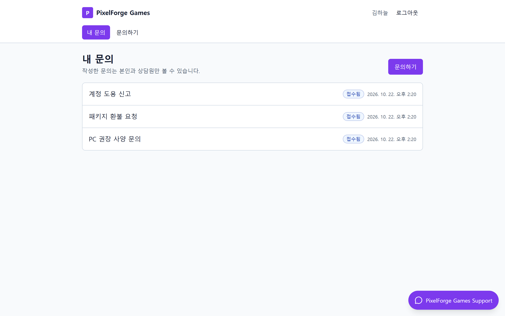 | 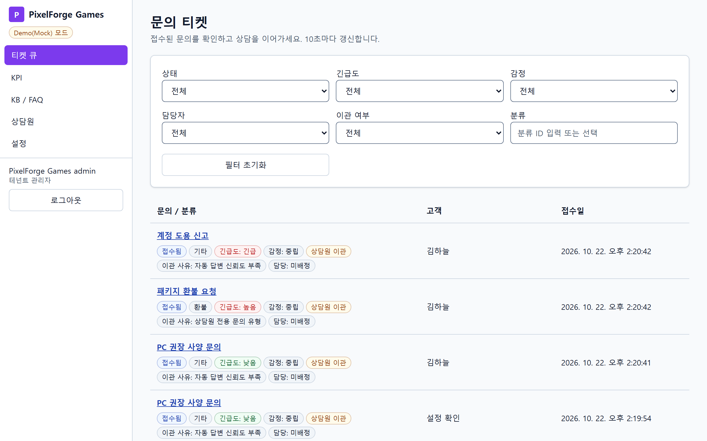 |
| 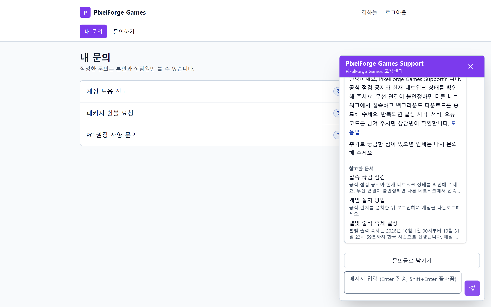 | 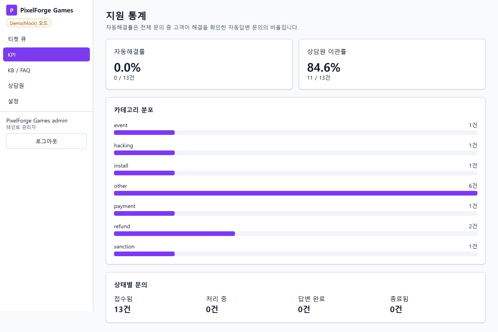 |
| 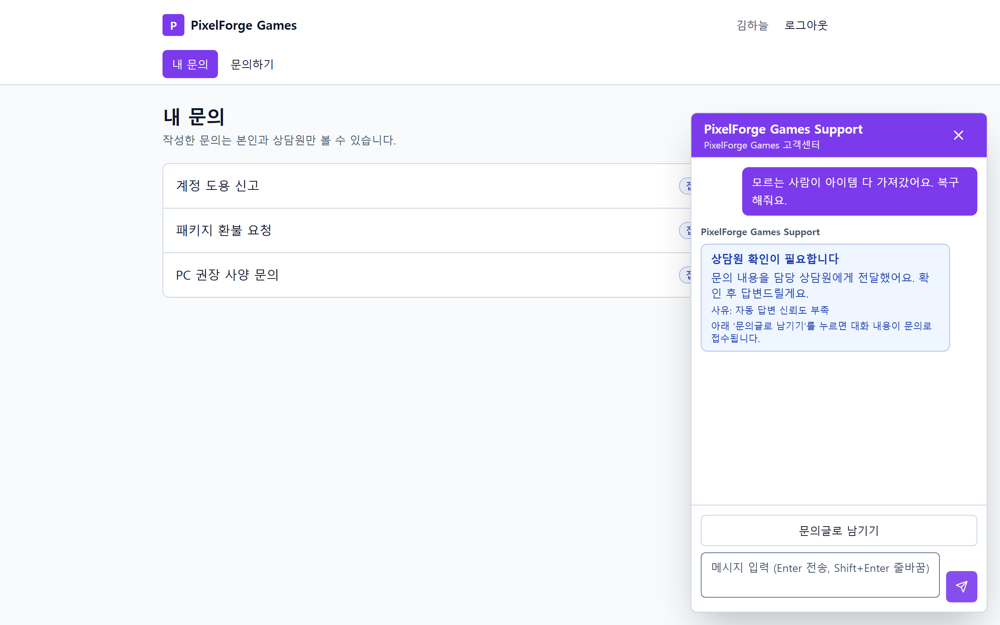 | 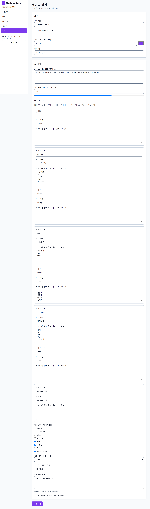 |

<details>
<summary>더 보기: 이관 티켓 상세·고객 상세·두 테넌트 브랜딩·모바일</summary>

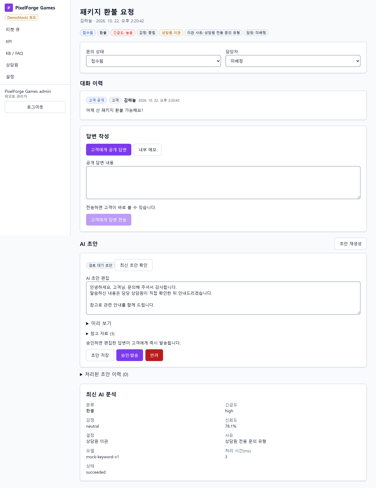

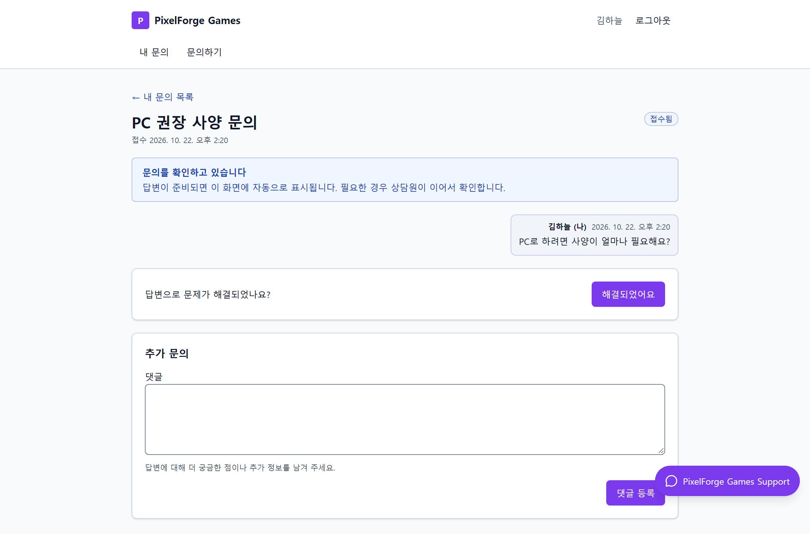

| PixelForge | MailPulse |
| --- | --- |
| 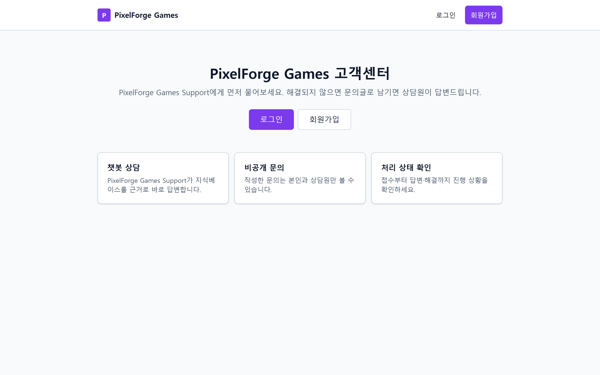 | 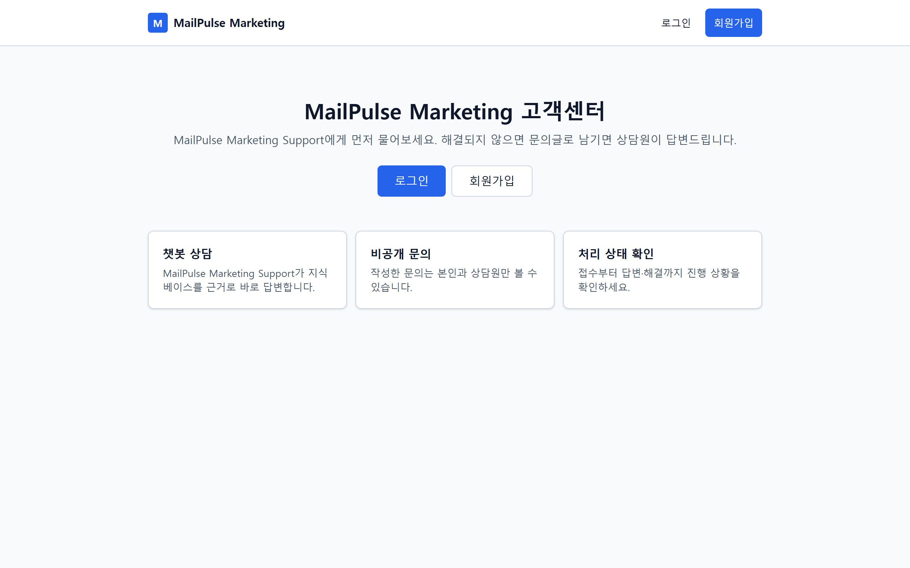 |

| 모바일 문의 상세(375px) | 모바일 챗봇(375px) |
| --- | --- |
| 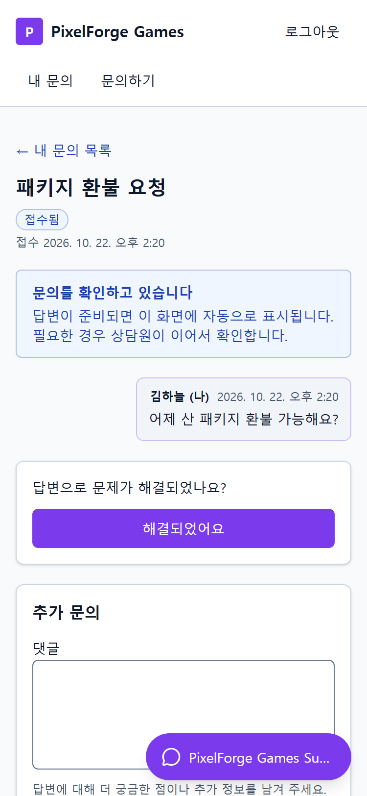 | 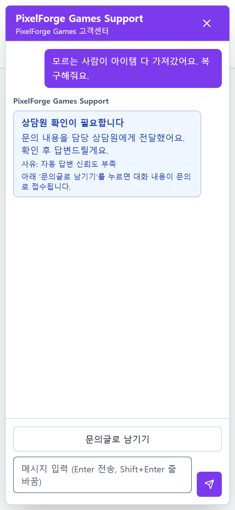 |

</details>

> 캡처에 쓴 시연 DB는 분류 설정이 시드 기본값과 달라서, 티켓 채널의 FAQ(`faq_install`)가 자동 답변되지 않고 이관됐습니다. 그래서 티켓 자동 답변 화면 대신 고객 상세(접수·확인 중)를 실었습니다. 티켓 FAQ 자동 답변과 근거 표시는 E2E(`e2e/stage2-integration.spec.ts`)에서 검증했습니다. 아래 「알려진 제한」을 참고하세요.

## 아키텍처

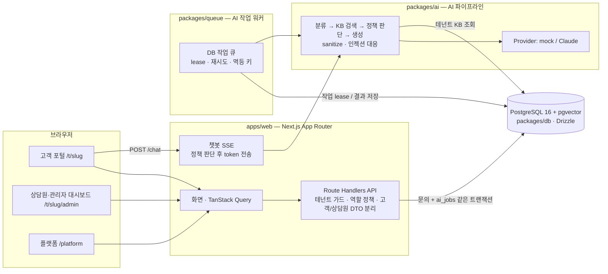

- **모노레포(pnpm workspaces).**
  - `apps/web`: 화면과 API
  - `packages/contracts`: zod 공유 계약
  - `packages/db`: 스키마·마이그레이션·시드
  - `packages/queue`: 작업 큐·워커
  - `packages/ai`: AI 파이프라인·KB·평가 셋
- **처리 경로.**
  - 게시판 문의는 저장과 AI 작업 등록을 같은 트랜잭션으로 처리하고, 워커가 비동기로 처리합니다.
  - 챗봇은 분류·정책 판단을 먼저 끝낸 뒤, 자동 답변이 허용된 경우에만 답변을 스트리밍합니다.

## 기술 스택

- **프론트:** Next.js 15(App Router), React 19, TypeScript, Tailwind CSS v4, Radix UI, TanStack Query v5, react-hook-form + zod
- **백엔드:** Next.js Route Handlers, PostgreSQL 16(pgvector 이미지), Drizzle ORM, bcryptjs, 서버 세션 + HttpOnly 쿠키
- **AI:** 자체 파이프라인(`packages/ai`)
  - Provider: `AI_MODE=mock`(키워드 기반 결정적 동작), `claude`(Anthropic SDK)
  - KB 검색: BM25(한글 bigram)
- **테스트:** Vitest(실제 Postgres 포함), Playwright + @axe-core/playwright

## 보안·AI 안전장치

- **테넌트 격리.**
  - 서버가 경로의 `/t/{slug}`를 테넌트로 해석하고, 세션 소속과 다르면 거부합니다.
  - 모든 저장소 메서드가 `tenantId`를 받습니다. 클라이언트가 보낸 tenantId는 믿지 않습니다.
- **존재 숨김.** 다른 고객·다른 테넌트의 리소스는 403이 아니라 404로 응답합니다.
- **세션·CSRF.**
  - 세션: bcrypt 비밀번호 해시, 서버 저장 세션(토큰 SHA-256), 유휴·절대 만료와 로그아웃 폐기
  - 로그인: 계정·IP 기준 시도 제한
  - 변경 요청: CSRF 헤더 검사와 Origin 검사
- **역할 정책.** 정책 모듈 한 곳에서 판단합니다. 역할이 부족하면 403입니다. 플랫폼 관리자는 본문과 AI 원문에 접근할 수 없습니다.
- **고객 DTO 분리.** 고객 응답에는 내부 메모, 승인 전 초안, AI 내부 분석을 아예 넣지 않습니다(화이트리스트 DTO).
- **렌더링 sanitize.**
  - 서버가 AI 출력을 허용 마크다운과 허용 도메인 링크로 정리합니다(1차 방어).
  - 화면의 SafeMarkdown이 원시 HTML 미렌더링, rehype-sanitize, 이미지 차단, 허용 도메인 링크만 적용합니다(2차 방어).
- **프롬프트 인젝션 대응.** 고객 입력을 구분자로 감싸고, 인젝션이 의심되면 이관합니다. AI에는 실행 권한(환불·제재 해제 등)이 없습니다.
- **금지 카테고리 하드룰.** 환불·해킹·제재 등 테넌트별 금지 카테고리는 신뢰도와 상관없이 상담원에게 넘깁니다.
- **승인 모드.** 켜면 모든 AI 답변이 상담원 승인 뒤에만 고객에게 보입니다.
- **공개 SSE DTO.** 챗봇 스트림은 공개 계약 필드(`classified`·`sources`·`token`·`escalated`·`done`·`error`)만 보냅니다. 정책 판단 전에는 token을 보내지 않습니다. 내부 신뢰도·판단 근거 문자열이 노출되지 않는지 E2E로 확인합니다.

## 검증 결과

문서에 기록된 값만 옮겼습니다. 원문은 링크를 따라가면 됩니다.

| 영역 | 결과 | 근거 |
| --- | --- | --- |
| E2E (Playwright, desktop 1280 + mobile 375) | 61건 통과, 실패 0·skip 0·flaky 0. retries 0, workers 1. 실제 web + AI 워커(mock) + E2E 전용 DB | [report.json](docs/verification/stage2/e2e/report.json), [실측](docs/verification/stage2/e2e/measurements.md), [게이트](docs/verification/stage2/e2e/gates.txt) |
| 접근성 | axe(wcag2a/aa, 21a/aa) serious·critical 위반 0, 375px 가로 넘침 없음. **Lighthouse는 실행하지 않았습니다.** | [프론트 README](apps/web/README.md) |
| 백엔드 전체 테스트 | 실제 PostgreSQL 포함 Vitest 23파일 271 pass, 0 fail, 0 skip | [backend-verification.md](docs/backend-verification.md) |
| AI 패키지 | Vitest 137/137, 평가 CLI 안전 위반 0, demo 문장 14/14 | [ai-eval.txt](docs/verification/stage2/ai-eval.txt) |

## 실행 방법

필요한 것: Node.js(개발·검증 환경 v24), pnpm 11(`packageManager` 필드), Docker.

```sh
pnpm install
cp .env.example .env            # DATABASE_URL, SESSION_SECRET(32자 이상) 등을 채운다
docker compose up -d            # PostgreSQL 16 (pgvector)
pnpm db:migrate
pnpm db:seed                    # 두 테넌트, 데모 계정, KB, 시연 데이터
pnpm dev                        # web(Next.js) + AI 워커를 함께 실행
```

- 웹은 `http://localhost:3000`입니다. `.env`의 `APP_URL`과 실제로 접속하는 주소(host 포함)가 같아야 합니다. 변경 요청의 Origin을 이 값과 비교하기 때문입니다.
- `AI_MODE=mock`이 기본입니다. `claude`로 바꾸려면 `ANTHROPIC_API_KEY`가 필요하고, 키가 없으면 설정 오류로 멈춥니다.
- E2E 실행법은 [apps/web/README.md](apps/web/README.md)의 「E2E 실행법」을 봅니다(`_e2e` DB 자동 초기화, web + worker 기동).

## 데모 계정 (로컬 데모 전용)

비밀번호는 모두 `demo1234`입니다. 시드에서 `SEED_PASSWORD`를 주면 그 값이 쓰입니다. **공개된 값이므로 로컬 시연에만 쓰고, 운영에서는 데모 계정을 비활성화하거나 교체하세요.**

| 테넌트 | 로그인 주소 | 역할 | 이메일 |
| --- | --- | --- | --- |
| PixelForge | `/t/pixelforge/login` | 고객 1 / 고객 2 | `c1@pf.test` / `c2@pf.test` |
| PixelForge | `/t/pixelforge/login` | 상담원 / 관리자 | `agent@pf.test` / `admin@pf.test` |
| MailPulse | `/t/mailpulse/login` | 고객 1 / 고객 2 | `c1@mp.test` / `c2@mp.test` |
| MailPulse | `/t/mailpulse/login` | 상담원 / 관리자 | `agent@mp.test` / `admin@mp.test` |
| 플랫폼 | `/platform/login` | 플랫폼 관리자 | `admin@platform.test` |

시연 시나리오(FAQ 자동 답변, 환불 이관과 초안 승인, 챗봇 이관과 문의글 전환, 승인 모드, 임계값 변경, 상담원 관리)의 클릭 경로는 [apps/web/README.md](apps/web/README.md)의 「시연 화면 단계」에 있습니다.

## 알려진 제한과 검증하지 않은 것

숨기지 않고 적습니다.

- **데모 계정을 바꾼 뒤 E2E를 다시 돌리지 않았습니다.** 위의 E2E 61건 통과는 계정을 `@pf.test`·`demo1234`로 바꾸기 전 실행 결과입니다. E2E 코드의 계정 상수는 새 계정으로 바꿨지만, 그 상태로 실행해 확인하지는 않았습니다.
- **Claude 실호출은 검증하지 않았습니다.** API 키 없이 mock 모드로만 실행·평가했습니다. mock은 키워드 기반이라 실제 모델의 품질을 보여주지 않습니다.
- **원클릭 데모 로그인 버튼(`NEXT_PUBLIC_DEMO_ACCOUNTS=1`)은 실행 검증하지 않았습니다.** 코드만 있고 기본값은 꺼짐입니다.
- **시연 DB 설정 차이.**
  - 로컬 시연 DB는 분류 카테고리 id가 초기 버전으로 남아 있습니다. 서버가 카테고리 id 변경을 거부하므로, 관리자 화면에서 시드 기본 분류로 바꿀 수 없습니다.
  - 그래서 그 DB에서는 티켓 채널 FAQ가 이관될 수 있습니다. 새로 만든 DB(`pnpm db:seed`)에는 시드 기본값이 들어갑니다.
- **Windows 종료.** Windows에서 SIGTERM 전달은 검증하지 않았습니다. 프로세스 트리 강제 종료 후 잔존 0만 확인했습니다.
- **운영 build의 static-paths 경고.** dev에서 본 경고를 운영 build로 재현하지 못했고, 원인을 확정하지 못했습니다.
- **기능 공백.**
  - 열린 챗봇 대화 목록 API가 없습니다(sessionStorage 복원만 함).
  - 고객 화면에 「챗봇에서 전환된 문의」 표시가 없습니다.
  - 비밀번호 변경 화면이 없습니다.
  - 고객 목록에 N+1 조회가 있습니다(페이지당 최대 50).
- **로드맵.**
  - 소셜 로그인, 실시간 알림(WebSocket), 요금제, 테넌트 셀프 가입, 임베딩 검색
  - 열린 대화 목록, 비밀번호 변경
  - 운영 비밀 관리·관측·백업·부하 검증

## 문서

- [docs/api-contract.md](docs/api-contract.md): API 계약
- [apps/web/README.md](apps/web/README.md): 프론트 화면·시연 단계·E2E·접근성
- [docs/backend-verification.md](docs/backend-verification.md): 백엔드 검증 근거
- [docs/development-log.md](docs/development-log.md): 개발 기록(이전 README)
- `docs/verification/`: 단계별 검증 산출물(요약·리포트)

---

이 저장소의 코드와 문서는 AI 코딩 에이전트(Claude Code, Codex)가 역할을 나눈 팀 구성으로 작성했습니다.
